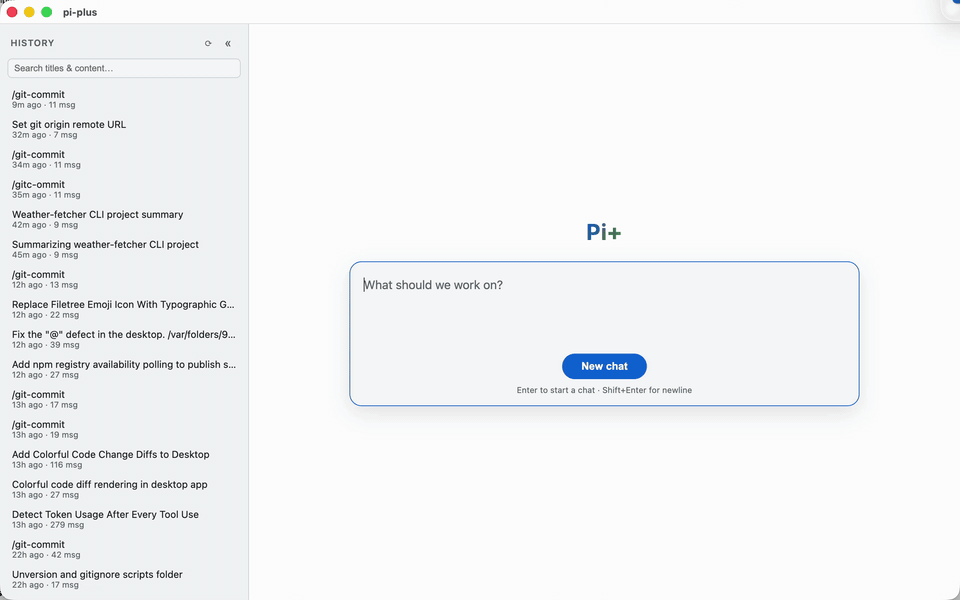

  
  <h1>pi-plus-desktop</h1>
  
Desktop app for <a href="https://github.com/pi-plus-org/pi-plus">pi-plus</a> — multi-tab AI agent sessions with profile management, built on Electron and embedding <code>pi-plus-sdk</code> directly in the main process (no CLI subprocess).

  

    
  

  

## Installation

1. **Download** the package for your platform from the [GitHub releases page](https://github.com/pi-plus-org/pi-plus-desktop/releases/latest):
   - **macOS**: `Pi+-<version>.dmg` — open it and drag **Pi+** into `/Applications`. The build is ad-hoc signed and not notarized, so on first launch use **right-click → Open** (or allow it under System Settings → Privacy & Security).
   - **Windows (x64)**: `Pi+-<version>-win-x64.msi` — run the installer (accept the UAC prompt): it installs to `C:\Program Files\Pi+` and adds a Start-menu shortcut; uninstall via Settings → Apps. New versions replace the old one in place. The build is unsigned, so SmartScreen may intervene on first run — **More info → Run anyway**.
2. **Authenticate** — add a provider token under Settings → Profiles (⌘, / Ctrl+,). Pi+ uses the same `~/.pi/agent` directory as the pi CLI and creates it on first use; an existing setup (and its sessions and profiles) is picked up as-is. On Windows that's `%USERPROFILE%\.pi\agent`.

## Usage

### Starting a chat

On launch you land on the **Pi+** screen — type what you want to work on and press Enter (or click **New chat**, or press ⌘N/Ctrl+N anywhere). The first chat asks for a **working folder**: the session's CWD is where the agent reads and edits files. Every tab is one agent session; the + button at the end of the tab bar opens another, and tabs are switched with ⌘⇧[ / ⌘⇧] (Ctrl on Windows/Linux). Drafts and pending attachments are kept per-tab and park/restore as you switch.

### The chat box

- The rounded 3-line input takes long drafts (they scroll inside); **Enter** sends, **Shift+Enter** is a newline, **Esc** stops the agent while it streams.
- **Paperclip** — attach files or folder paths to your message.
- **⋯ menu** — per-session capabilities: rename, clone (branch with full history), change folder (`/cd`), fork from message, rewind, and create/improve `AGENTS.md` (`/init`).
- **✎** — round-trip the draft through your external editor (also ⌘⌥E / Ctrl+Alt+E).
- **`/`** — typing a slash at line start pops the session-executable commands (extension commands, prompt templates, skills) with arrow-key selection.
- **Steering** — sending while the agent is still working queues the message as *steer* (redirect now) or *follow-up* (run after); the "⇢ next: …" chip in the status strip toggles the mode, ✕ clears the queue.

### Status strip & tool output

Above the chat box the status strip carries the model & thinking-level pickers (the model list is scoped to the tab's profile), a skills popover, manual compact (abortable), the queue chip, the last exchange's usage & cost, and a right-aligned context-usage gauge. In the transcript, thinking blocks and tool executions are collapsible rows — file edits render as colorful diffs, bash runs show their output.

### History sidebar (left)

All past sessions, newest first, with a search box matching titles and full transcript content. **⌘B** toggles the panel, **⌘R** (or the header ⟳) reloads it. Click a row to resume the session in a new tab — or to activate the tab if it's already open. Drag the panel's right edge to resize (double-click restores the default width); the width is persisted. Transcripts are not deletable from the UI.

### File tree (right)

The active session's working folder as a lazy tree. Agent edits appear automatically; click a row to select it, then **⌂** reveals that file/folder in Finder/Explorer (with nothing selected it reveals the working folder itself). Toggle with **View → Toggle File Tree** (⌘⌥B / Ctrl+Alt+B); the panel is drag-resizable and hides itself when no tab is open.

### Profiles & settings

Profiles (model/provider credentials, in `~/.pi/profiles.json`, materialized to isolated agent dirs like the `pipi` CLI's) are managed from the native app menu; each tab shows its profile as a badge. **⌘,** opens Settings: **Editors** (picker of installed blocking-GUI editors for the ✎ button), **Compaction** (auto-compact on/off, compact-at threshold, context floor and window cap — the same controls as the TUI `/settings`). Light & dark themes follow the system by default, with a manual override under **View → Theme**.

### Shortcuts

| | macOS | Windows/Linux |
| --- | --- | --- |
| New chat | ⌘N | Ctrl+N |
| Close tab | ⌘W | Ctrl+W |
| Previous / next tab | ⌘⇧[ / ⌘⇧] | Ctrl+Shift+[ / ] |
| Toggle history sidebar | ⌘B | Ctrl+B |
| Reload history list | ⌘R | Ctrl+R |
| Toggle file tree | ⌘⌥B | Ctrl+Alt+B |
| Edit draft in external editor | ⌘⌥E | Ctrl+Alt+E |
| Settings | ⌘, | Ctrl+, |
| Stop the agent | Esc | Esc |

Every button that has a shortcut shows the chord in its hover tooltip.

## Features

- **Multiple tabs**, one agent session per tab
- **Session history sidebar** managed through SDK APIs (`SessionManager.listAll` / `search` / `deleteSession`): flat list ordered by last activity (newest first), a search box matching titles and full transcript content via the SDK, streaming indicator per open session, the active tab's session highlighted, click activates an already-open tab (or resumes into a new one); transcripts are not deletable from the UI; drag the panel's right edge to resize it (double-click restores the default; the width is persisted), reload the list with the header ⟳ button or ⌘R/Ctrl+R, and hide or show it with the header « button or ⌘B/Ctrl+B (hidden, only a » button remains at the window's edge)
- **Profile management** delegated to `pi-plus-sdk`'s pi-hub profile API (profiles in `~/.pi/profiles.json`), via the native app menu and a per-tab profile badge
- Full streaming chat UI: markdown rendering, collapsible thinking blocks, tool execution rows, compaction and retry notices
- **Session capabilities** per tab, driven by SDK APIs — a "⋯" menu right of the paperclip in the composer: rename, clone (in-place branch with full history), change folder (`/cd`), fork from message, rewind, create/improve `AGENTS.md` (`/init`)
- **Chat box**: a fixed 3-line rounded input (long drafts scroll inside) whose bottom strip carries the paperclip, the "⋯" session menu and the ✎ external-editor button on the left and a round Send (↑, Esc = Stop while streaming) on the right; the chatbox and its status line are per-tab — drafts and pending attachments park and restore as you switch tabs
- **Composer status strip** (above the chat box): model & thinking-level pickers (the model list is scoped to the tab's profile models), skills popover (click to insert `/skill:name`), manual compact with abort-while-compacting, the send-mode/queue chip, the last exchange's usage & cost, and a right-aligned context-usage gauge
- **Slash-command menu**: typing `/` at the start of a line pops the session-executable commands (extension commands, prompt templates, skills) with arrow-key selection, like the TUI
- **Steering queue**: sending while the agent streams queues the message as steer or follow-up — the "⇢ next: …" chip in the status strip toggles the mode and ✕ clears the queue
- **Compaction settings** under Settings (⌘,) → Compaction: auto-compact on/off (default profile's agent dir, shared with pipi), compact-at threshold, context floor and context-window cap — same controls as the TUI `/settings`
- **External editor** for the chat draft: the ✎ button in the chat box's bottom strip (also ⌘⌥E / Ctrl+Alt+E) round-trips the draft through an external editor; Settings (⌘,) → Editors is a picker of installed blocking-GUI editors (VS Code, GVim, Sublime, Zed, …, probed on PATH plus the well-known install dirs — `/usr/local/bin`, `/opt/homebrew/bin` on macOS; the VS Code/VSCodium/Cursor/Sublime/Zed/Vim locations on Windows — since Finder/Dock/Start-menu launches get a minimal PATH), stored as absolute commands and re-resolved at spawn; the command is hand-editable (portable installs, wrapper scripts) with Reset restoring the detected one. There is no system default ($VISUAL/$EDITOR) — pick one explicitly. Terminal editors have no TTY here
- **Pinned chrome**: tab bar, composer status strip and input row never move — only the message area and the history list scroll, each independently
- **Tab & panel shortcuts** (⌘ on macOS, Ctrl elsewhere): ⌘N (or the ⌘T alias, or the + button — sits right after the last tab, pinned to the bar's right edge when the tabs overflow) for a new chat/tab, ⌘W close tab (on other windows, e.g. Settings, ⌘W closes the window; ⌘⇧W always closes the main window), ⌘⇧[ / ⌘⇧] cycle tabs, ⌘B toggle the history panel, ⌘R reload the history list, ⌘⌥E edit the draft in the external editor, ⌘, settings — buttons that have a shortcut show it in their hover tooltip
- Light & dark themes, following the system appearance by default, with a manual override under View → Theme (persisted across launches)
